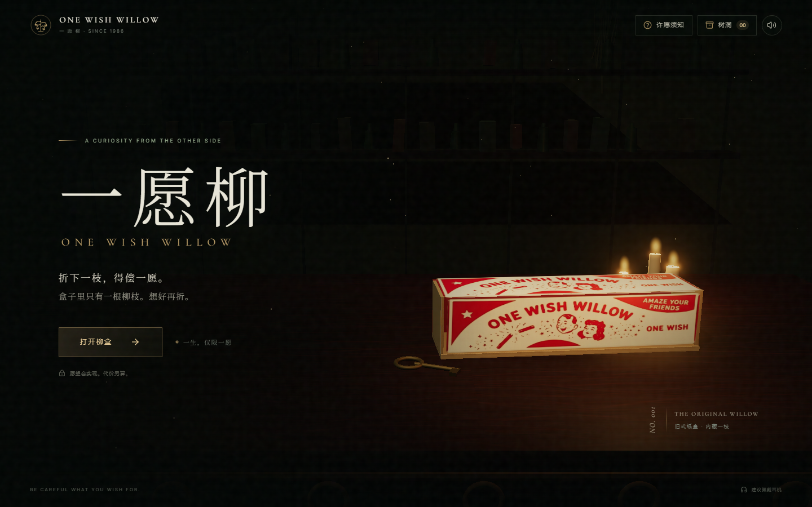
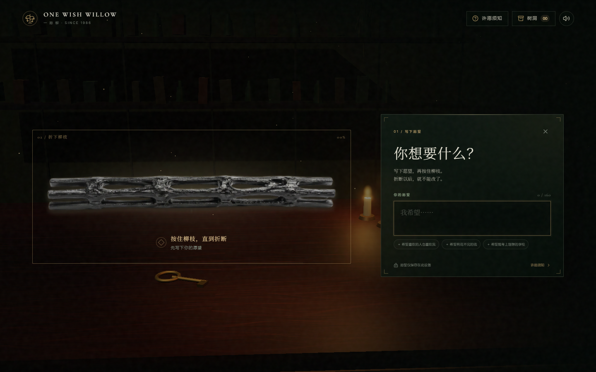
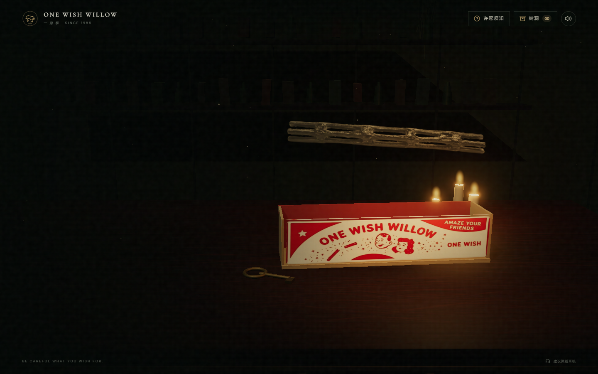

<div align="center">

# 一愿柳

### ONE WISH WILLOW

**盒子里只有一根柳枝。想好再折。**

开盒、写下愿望、按住折枝，读到属于这次愿望的结局。<br />A cinematic, browser-based wishing ritual built with React and Three.js.

[](LICENSE) [](package.json) [](tsconfig.app.json) [](src/components/WillowScene.tsx) [](vite.config.ts)

[画面预览](#画面预览) · [快速开始](#快速开始) · [开发指南](#开发指南) · [参与贡献](CONTRIBUTING.md) · [反馈问题](https://github.com/Rosatus/onewishwillow/issues)

</div>



## 关于一愿柳

你走进一间旧店，桌上放着一个柳盒。盒背写着：折下一枝，得偿一愿。

一愿柳是一段可以亲手推进的悬疑故事。打开盒子，写下想要的东西，再按住柳枝，直到它折断。愿望实现以后，还有一些事情会发生。

场景由 Three.js 实时渲染，交互由 React 管理。故事来自仓库内的预设文本，按愿望关键词选择；**无需账号、后端服务或 API Key**。适合直接体验，也适合拿来研究网页中的场景、音效与叙事交互。

> 本项目为虚构互动故事。愿望内容和历史记录保存在当前浏览器中。

## 画面预览

### 写下愿望，折下柳枝

柳枝是画面的主要交互对象。桌面端与输入面板并排，手机端排列在输入框下方。



<details>
<summary><strong>查看开盒过程</strong></summary>

上盖翻开并退场，露出盒内空间，柳枝从盒中升起。



</details>

## 体验里有什么

| | 体验 |
| --- | --- |
| **一间旧店** | 实时 3D 场景、木桌、烛光、微尘与轻微视差，配合环境音效。 |
| **一次开盒** | 盒盖与盒体分离，完成翻盖、退场和柳枝升起的过渡。 |
| **一根柳枝** | 按住约两秒，看到弯折与进度反馈；松手取消，折断后进入结局。 |
| **几种走向** | 感情、财富、事业、健康与通用故事，使用本地关键词匹配和预设文本。 |
| **一个树洞** | 保存最近 12 次愿望，可重新打开阅读，也可以重新体验。 |
| **多种操作方式** | 鼠标、触屏、键盘均可折枝；提供静音和减少动态效果适配。 |

### 怎么玩

1. 点击 **打开柳盒**。
2. 输入 4–160 字的愿望，或选择一个示例。
3. 按住柳枝约两秒；中途松手可以取消。键盘用户聚焦柳枝后按住 `Space` 或 `Enter`。
4. 阅读结局。你可以回到首页、重新体验，或从右上角的 **树洞** 查看记录。

## 快速开始

准备 **Node.js 22.12+ 或 24+**、npm 和支持 WebGL 的现代浏览器。本项目已在 Node.js 24 下验证。

```bash
git clone https://github.com/Rosatus/onewishwillow.git
cd onewishwillow
npm ci
npm run dev
```

打开终端中 Vite 打印的地址，默认是 `http://localhost:3000`。端口被占用时，以终端显示为准。

无需配置环境变量或申请 API Key。

## 构建与部署

```bash
npm run build
npm run preview
```

`build` 会先执行 TypeScript 检查，再生成 `dist/`。`preview` 用于在本地检查构建产物。

部署时，将 **`dist/` 目录中的内容**发布到静态网站托管服务即可：

| 配置项 | 值 |
| --- | --- |
| 安装命令 | `npm ci` |
| 构建命令 | `npm run build` |
| 输出目录 | `dist` |
| 环境变量 | 无必填项 |

Vite 已配置 `base: './'`，资源使用相对路径，可部署在子目录中。推荐使用 HTTPS。当前仓库未配置自动部署；仓库地址不是在线体验地址。

## 开发指南

### 常用命令

| 命令 | 用途 |
| --- | --- |
| `npm run dev` | 启动本地开发服务器 |
| `npm run build` | 类型检查与生产构建 |
| `npm run preview` | 预览生产构建 |
| `npm run verify` | 运行 Playwright 交互检查并保存截图 |
| `npm run lint` | 运行仓库配置的 ESLint 检查 |

### 代码导航

```text
onewishwillow/
├── public/assets/
│   ├── images/                 # 柳盒、完整柳枝与断枝素材
│   └── audio/                  # 环境音与折枝音效
├── src/
│   ├── App.tsx                # 页面流程、愿望输入、结局与树洞
│   ├── App.css                # 场景叠层、动效与响应式布局
│   ├── components/
│   │   ├── WillowScene.tsx    # Three.js 场景与开盒动画
│   │   └── BranchRitual.tsx   # 长按、取消与折枝反馈
│   └── lib/
│       ├── wishes.ts          # 愿望分类和故事文本
│       └── audio.ts           # 音频播放与合成音效
├── scripts/verify.mjs          # 浏览器检查
├── docs/images/                # README 展示截图
└── LICENSE                    # AGPL-3.0 完整文本
```

### 从哪里改起

| 想修改的内容 | 入口 |
| --- | --- |
| 首页、按钮、规则和提示文案 | [`src/App.tsx`](src/App.tsx) |
| 故事分支、关键词和结局 | [`src/lib/wishes.ts`](src/lib/wishes.ts) |
| 长按时长与输入响应 | [`src/components/BranchRitual.tsx`](src/components/BranchRitual.tsx) |
| 灯光、镜头、盒体和开盖过程 | [`src/components/WillowScene.tsx`](src/components/WillowScene.tsx) |
| 布局、色彩、字形和动画 | [`src/App.css`](src/App.css)、[`src/index.css`](src/index.css) |
| 环境音与折枝声音 | [`src/lib/audio.ts`](src/lib/audio.ts)、[`public/assets/audio`](public/assets/audio) |

主流程为 `hero → opening → ritual → oracle → answer`，由 `App.tsx` 管理。结局由 `createWishRecord()` 创建，再写入本地历史记录。

## 交互验证

首次运行前安装 Playwright 使用的 Chromium：

```bash
npx playwright install chromium
npm run verify
```

Linux 环境缺少浏览器系统依赖时，可使用 `npx playwright install --with-deps chromium`。

检查脚本会启动独立的 Vite 服务，使用 **7100 端口**，覆盖：

- 桌面场景加载、开盒、许愿与结局展示。
- 长按中途松手取消，以及手机触屏折枝。
- 键盘折枝、减少动态效果与重新体验。
- 历史记录读取和刷新后的保存状态。
- 退出时取消待执行的开盒切换、规则弹窗与手机横向溢出检查。

报告写入 `artifacts/verification.json`，过程截图保存在同一目录。`artifacts/` 已加入 `.gitignore`；README 使用单独保存的展示截图。

## 数据与边界

- **愿望留在浏览器里。** 使用 `localStorage` 保存最近 12 条记录，不上传愿望文本；清除网站数据会删除记录。不同浏览器和设备之间不自动同步。
- **故事是预设的。** 当前实现按关键词分类，不理解任意自然语言，也不会为每个愿望生成独立故事。
- **字体有外部请求。** 页面从 Google Fonts 加载字体；无法访问时使用系统回退字体。
- **声音需要操作后播放。** 环境音在用户交互后启动，可随时通过右上角按钮关闭。
- **场景依赖 WebGL。** 不同设备的画质与性能可能不同；动画会遵循系统的减少动态效果设置。

## 参与贡献

欢迎改进故事、交互、移动端体验和渲染性能。开始前请阅读 [贡献指南](CONTRIBUTING.md)。

遇到问题时，请在 [Issues](https://github.com/Rosatus/onewishwillow/issues) 中提供浏览器、设备信息、复现步骤，以及相关截图或报错。较大的设计或行为调整，建议先开 Issue 说明预期效果。

## 开源协议

本项目采用 **GNU Affero General Public License v3.0 only**，SPDX 标识为 **`AGPL-3.0-only`**。

使用、修改和分发本项目须遵守 [LICENSE](LICENSE) 中的完整条款，包括适用的源代码提供要求。第三方依赖仍遵循各自的许可证。

---

<div align="center">
<sub>一愿柳 · ONE WISH WILLOW</sub>
</div>
